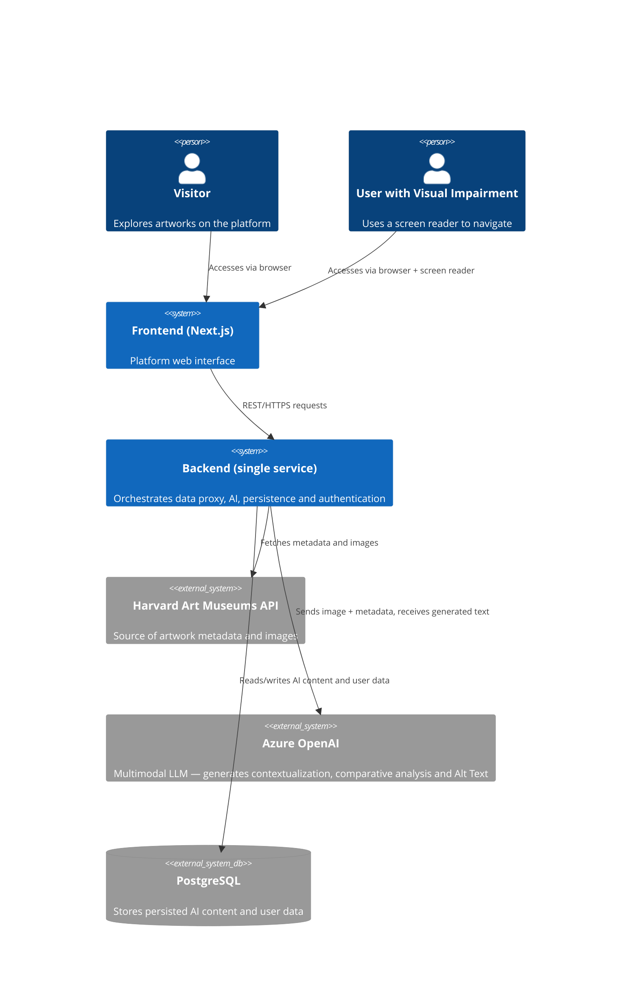
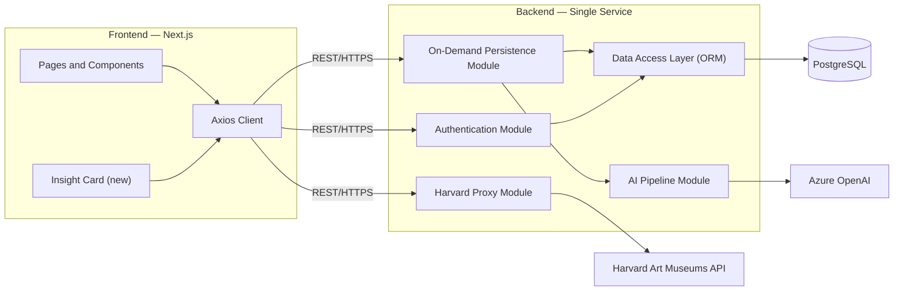
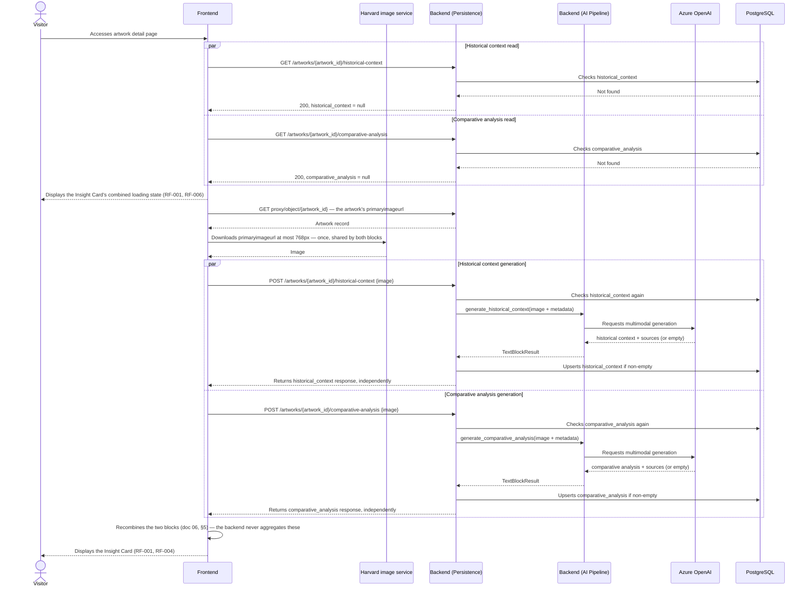
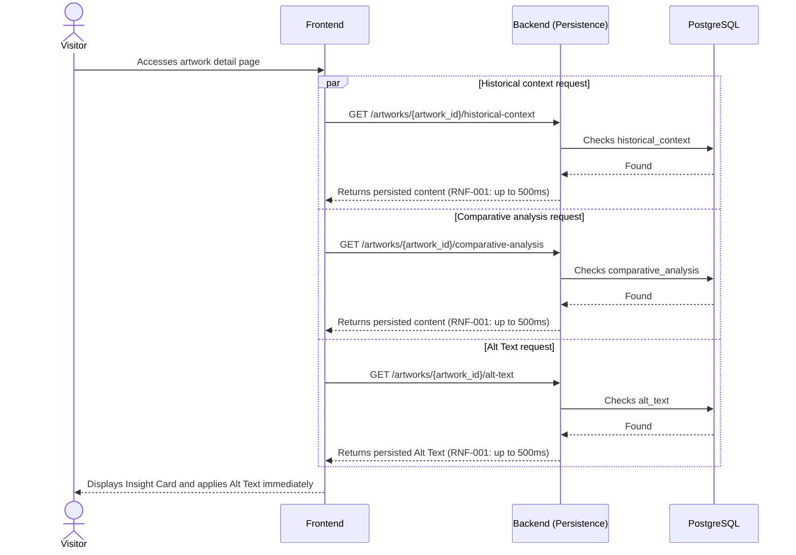
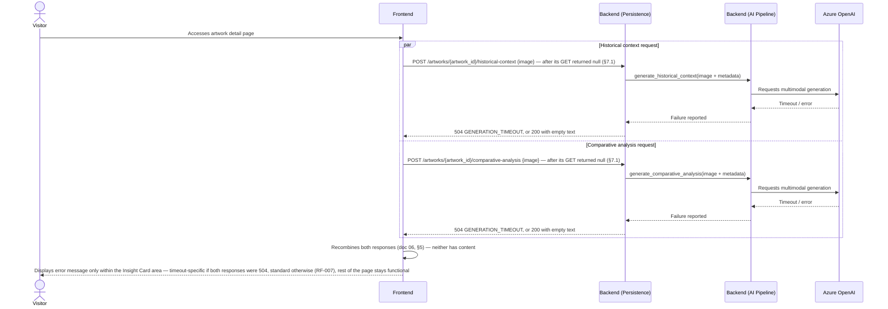
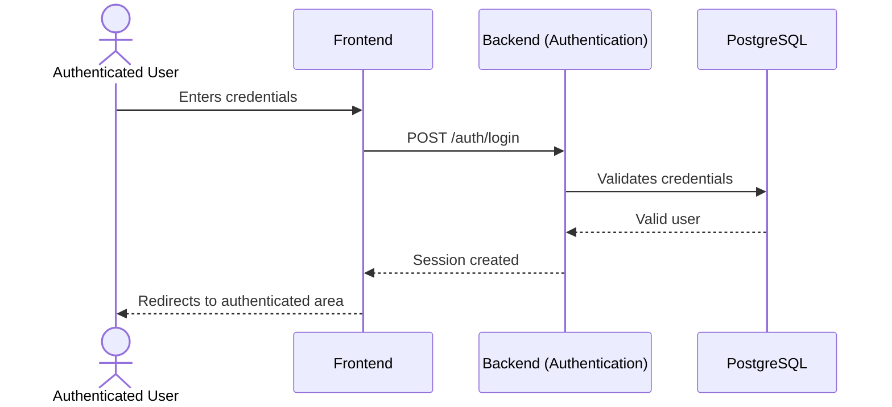
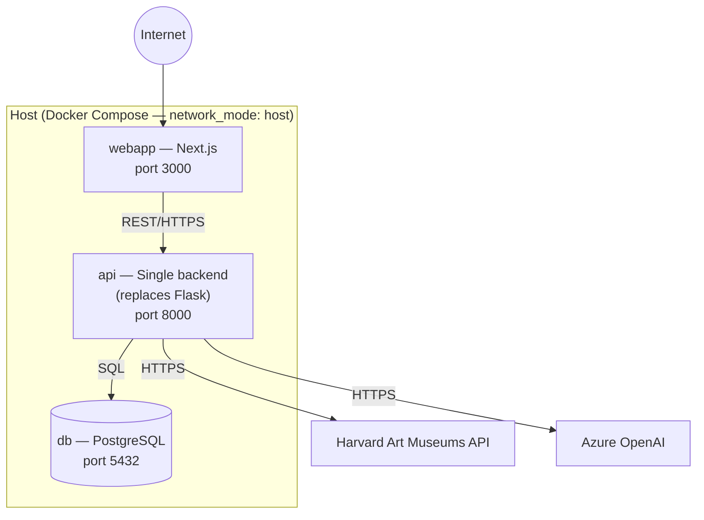
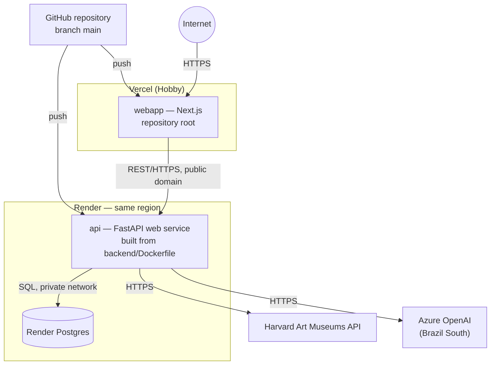

# System Architecture — Art Archive AI

**Version:** 1.4
**Date:** 2026-10-30
**Status:** In review
**Base documents:** [01 — Vision and Scope](./01-vision-scope.md), [02.1 — Insight Card](./requeriments/02.1-insight-card.md), [02.2 — Alt Text](./requeriments/02.2-alt-text.md), [02.4 — Authentication](./requeriments/02.4-authentication.md), [02.5 — Non-Functional](./requeriments/02.5-non-functional.md), [03 — Use Cases](./03-use-cases.md)

> **Change Note (2026-07-26):** requirement IDs throughout this document have been remapped from the original flat `02-requirements.md` numbering to the current split numbering (docs 02.1–02.5) — the numbers no longer align 1:1 with the previous revision. Two substantive updates: (1) the AI Pipeline module (§4) is now invoked as **three independent calls** — historical context, comparative analysis, and Alt Text are each checked, generated, and persisted on their own, per RF-001 (doc 02.1) and RF-013 (doc 02.2), instead of one combined call; (2) the Authentication module is now **email/password only** (RF-026, doc 02.4), with no Google OAuth path.
>
> **Change Note (2026-07-26, addendum):** the system policy is that **no register is ever physically deleted** — records are logically retired via an `expired_at` timestamp column (soft delete) instead. This is now reflected in §5 (Database macro view) and §9 (Decision 6). See doc 05 for the full column definition on `users` and `artwork_ai_content`.
>
> **Change Note (2026-07-26, §7 correction):** the sequence diagrams in §7 are corrected to show **three fully independent HTTP requests** fired by the front-end on artwork visit — `GET /artworks/{artwork_id}/historical-context`, `GET /artworks/{artwork_id}/comparative-analysis`, and `GET /artworks/{artwork_id}/alt-text` (doc 07, §4) — instead of one bundled `GET /artworks/{artwork_id}/insight-card` request covering all three blocks. The historical-context and comparative-analysis responses are still recombined into a single Insight Card loading/displayed/error state, but that recombination now happens in the **front-end**, once both of its independent responses have settled (doc 06, §5) — the backend performs no such aggregation.
>
> **Change Note (2026-10-28, §8):** the backend port, previously "to be defined", is recorded as **8000** (doc 99, Decision 4). §8 still describes the development host; the public deployment target is decided in doc 99 (Phase 7) and recorded here before any infrastructure is created.
>
> **Change Note (2026-10-29, §8, §9, §11) — public deployment target recorded (doc 99, Phase 7).** By author decision, the front-end runs on **Vercel** and the backend and database on **Render**, starting on Render's free instance types and upgraded as needed, both deployed from the GitHub repository. (Railway, chosen first the same day, was dropped: its new signups were paused after a security incident.) §8 now describes two environments: the development host (unchanged, §8.1) and the public deployment (new, §8.2). Decision 2 (§9) holds for development only; Decision 7 records the public target. The `network_mode: host` and CI/CD risks (§11) are updated accordingly.
>
> **Change Note (2026-10-30, §7, §8.2, §9, §11) — the artwork image comes from the browser.** Deployed on Render, the backend gets `403` from Harvard's image server, so it can no longer download the image the AI Pipeline needs. By author decision, the front-end downloads it and sends it with a new `POST` per Insight Card block, while the `GET` only reads (doc 07 v2.4, doc 06 v2.4, doc 09 v2.3). §7.1 and §7.3 are redrawn, §8.2 records the image path, Decision 4 is clarified, the new Decision 8 records that downloading from Harvard's image service is not a call to the Harvard API (doc 00, §2 rule 3), and §11 adds the accepted risk of a client-supplied image.

---

## 1. Architecture Overview

Art Archive AI follows a **client-server** style: a web front-end (Next.js) consumes a single back-end service via REST API, which in turn integrates three external systems — the Harvard Art Museums API (artwork data), Azure OpenAI (AI-generated content) and PostgreSQL (persistence).

**Structural change relative to the MVP:** the current back-end is a Flask proxy (`proxy/proxy.py`) with the single responsibility of forwarding calls to the Harvard API and authenticating users via the Firebase Admin SDK. This expansion **replaces that proxy with a new single service** (Python, e.g. FastAPI) that absorbs:

- the Harvard Art Museums API proxy (rewritten, preserving the contract currently consumed by the front-end),
- the AI content generation pipeline (Insight Card + Alt Text),
- the on-demand persistence mechanism,
- user authentication, implemented from scratch on top of PostgreSQL, fully replacing Firebase Auth.

There will not be two Python services coexisting permanently — Flask is discontinued at the end of the migration (see Section 9, Decision 1).

---

## 2. Actors and External Systems (Context Diagram)

---

## 3. Frontend Modules (Next.js)

The front-end keeps its existing structure (Next.js 14, App Router, TypeScript). No MVP module is rewritten; the expansion adds new components on top of the current base.

| Module                 | Location                                                                                         | Responsibility                                                                                                                                            |
| ---------------------- | ------------------------------------------------------------------------------------------------ | --------------------------------------------------------------------------------------------------------------------------------------------------------- |
| Grid and Filters (MVP) | `src/app/home/`                                                                                  | Artwork navigation and filters — unchanged                                                                                                                |
| Artwork Detail Page    | `src/app/object/[objectId]/page.tsx`                                                             | Displays metadata, images and artists — receives the new Insight Card                                                                                     |
| **Insight Card (new)** | `src/app/object/[objectId]/components/insightCard/`                                              | Displays historical context and comparative analysis (each independently available) and the combined loading/error states (RF-001, RF-005 through RF-008) |
| Authentication         | `src/app/login/`, `src/app/signUp/`, `src/actions/authActions.ts`, `src/hooks/useUserSession.ts` | Currently uses inert Firebase code; will consume the new backend's email/password-only authentication endpoints (RF-026 through RF-031)                   |
| HTTP Client            | `src/libs/axios/axios.ts`                                                                        | Axios instance pointing to the new single service (`NEXT_PUBLIC_API_URL`)                                                                                 |
| Global State           | `jotai` (used dispersedly across components)                                                     | Client-side state management — no structural changes foreseen                                                                                             |
| Route Middleware       | `src/middleware.ts`                                                                              | Protects authenticated routes via session cookie — will validate sessions issued by the new backend                                                       |

**Note:** the code under `src/libs/firebase/` (config and auth) is currently commented out/inert in the front-end. Since no Firebase data is migrated, it can be removed from the repository as soon as the new authentication endpoints (RF-026, RF-027) are functional — there is no transition window to wait for.

---

## 4. Backend Modules (Single Service)

The new service replaces `proxy/proxy.py` and is organized into the following internal modules:

| Module                    | Responsibility                                                                                                                                                                                                                       | Related Requirements                   |
| ------------------------- | ------------------------------------------------------------------------------------------------------------------------------------------------------------------------------------------------------------------------------------ | -------------------------------------- |
| **Harvard Proxy**         | Forwards and normalizes calls to the Harvard Art Museums API, preserving the contract currently consumed by the front-end (`/proxy/object/{id}`, `/proxy/object/{id}/people`, etc.)                                                  | Inherited from the MVP — no new RF     |
| **AI Pipeline**           | Exposes three independent generation functions — historical context, comparative analysis, and Alt Text — each building its own prompt from the artwork's image and metadata and calling multimodal Azure OpenAI on its own (doc 09) | RF-002, RF-003, RF-009, RF-010, RF-011 |
| **On-Demand Persistence** | Checks in the database, per block, whether the content already exists before triggering the corresponding AI Pipeline call; persists each block's result independently after successful generation (doc 06)                          | RF-001, RF-004, RF-013                 |
| **Authentication**        | Login, session creation and validation via PostgreSQL, built from scratch, email/password only — fully replaces token verification via the Firebase Admin SDK, with no third-party identity provider                                 | RF-026 through RF-031                  |
| **Data Access**           | ORM and migrations layer on top of PostgreSQL (e.g. SQLAlchemy + Alembic — to be confirmed in detail in doc 05)                                                                                                                      | RNF-003, RNF-006                       |

Every call to Azure OpenAI and to the Harvard Art Museums API happens **exclusively on the backend** — no API key is exposed to the front-end (RNF-005).

---

## 5. Database (Macro View)

This section presents only enough to give context to the architecture. The full model (ERD, data dictionary) is specified in `spcecs/05-database.md`.

- **AI content per artwork table**: stores historical context, comparative analysis, and Alt Text as three **independently nullable** columns, each with its own prompt version and generation timestamp, indexed by the artwork's identifier in the Harvard API — since each block is checked, generated, and persisted on its own (RF-001, RF-013). Carries an `expired_at` column for soft delete (see below).
- **Sources table**: stores zero or more source URLs per generated text block (historical context or comparative analysis), satisfying RF-010.
- **Users table**: stores identifier, email, name, and a password hash — email/password is the sole credential (RF-026), replacing the records currently kept in Firebase Auth. Carries an `expired_at` column for soft delete (see below).
- **Password reset tokens table**: single-use, expiring tokens backing the "Forgot Password"/"Change Password" flow (RF-029, RF-030).
- **Soft delete policy**: no register in this database is ever physically deleted. Retiring a user account or an artwork's AI content is modeled by setting `expired_at` to the moment of retirement; the row itself is preserved. A `NULL` `expired_at` means the register is active. Application queries that read "current" data (login, on-demand persistence checks) must filter on `expired_at IS NULL`.

---

## 6. Component Diagram

---

## 7. Call Flows (Sequence Diagrams)

### 7.1 First Visit to an Artwork — Independent Generation and Persistence (UC-01)

**Note:** each `par` branch above is a fully independent HTTP request (doc 07, §4), hitting its own backend request handler — they are drawn together only to show that the front-end fires them concurrently on the same visit. No shared backend state or synchronization point connects them; a slow or failed request never blocks or is blocked by the other. The one thing the two `POST`s share is the image, downloaded once on the front-end (doc 06, §5). The backend checks the database again on each `POST`, so the check before generating stays on the backend (§9, Decision 4). The backend's existence check against the Harvard API, before generation, is omitted from the drawing (doc 06, §2).

Alt Text, a third request in the original design, is deferred this cycle (doc 99, §2.2); its flow still assumes a server-side image download, recorded as a pending issue in doc 07 (§8).

---

### 7.2 Subsequent Visit — Cached Content (UC-02)

---

### 7.3 Generation Failure — Both Insight Card Blocks Fail (UC-03)

Alt Text is not shown in this diagram — it is a third, fully decoupled request (§7.1). A failure in `generate_alt_text` only affects the fallback message applied to the image (RF-011, scenario 3) and has no bearing on the Insight Card's state.

Note: if only **one** of the two Insight Card requests above fails, the flow does not reach this error path at all — the front-end's recombination (doc 06, §5) shows the successful block normally, with no error displayed (RF-007, scenario 1).

---

### 7.4 Platform Login (UC-06)

---

## 8. Deployment Architecture

Two environments: the development host (§8.1) and the public deployment (§8.2). Both run the same code from the same repository; only where each service runs differs.

### 8.1 Development host

The development environment remains **self-hosted via Docker Compose**, as in the MVP, with the addition of a container for PostgreSQL.

**Changes relative to the current `docker-compose.yml`:**

- The `api` service (currently built from `./proxy`, Flask) will now be built from the new single service.
- A new `db` service (official `postgres` image) is added, with a persistent volume for the data.
- The bind mount of `.firebaseAdminSDK.json` and all Firebase dependencies are removed from the `api` service from the very start of the new backend's implementation — there are no legacy users to validate, so there is no need to keep it during any transition window.
- Backend environment variables (Azure OpenAI key, PostgreSQL connection string, Harvard API key) continue to be provided via `env_file`, never hardcoded (RNF-005).

### 8.2 Public deployment

Recorded 2026-10-29 by author decision (doc 99, Phase 7). The three services run on two managed platforms, each connected to the GitHub repository and redeploying on every push to the deploying branch.

| Item | Decision |
| ---- | -------- |
| Front-end | Vercel, Hobby plan, project rooted at the repository root. Vercel builds Next.js itself; the root `Dockerfile` is not used. Artwork images come from `nrs.harvard.edu`, which redirects to `ids.lib.harvard.edu`. Harvard's image server refuses the fetch made by Vercel's image optimizer (502 `OPTIMIZED_EXTERNAL_IMAGE_REQUEST_UNAUTHORIZED`, observed 2026-10-29 with both hosts listed in `images.domains`), while browsers load it fine, so `next.config.mjs` sets `images.unoptimized: true` and the browser fetches each image straight from Harvard. Trade-off: no resizing by the optimizer, so the grid downloads each image at the size Harvard serves; it also takes the deployment out of Vercel's image-optimization quota (doc 99, Phase 8 can reduce the size with Harvard's own size parameters) |
| Backend | Render web service (runtime Docker) with root directory `backend/`, built from `backend/Dockerfile`. Listens on the port Render provides in `PORT` (8000 when unset, as in development) |
| Database | Render Postgres in the same region, reached by the backend through its internal URL. Render creates the database and its user at provisioning; that user owns the database and is not a superuser, which meets doc 99 (Phase 2) without an extra role, and `pgcrypto` — a trusted extension — is created by migration `0001` |
| Migrations | `alembic upgrade head` run by the author from the development machine against the database's external URL, whenever a new migration exists. Render offers a pre-deploy command on paid instances only; once the backend is upgraded, the migration moves there |
| Region | The same US East region for the backend and the database — the closest to Brazil, the Harvard API and Azure Brazil South |
| Domain | The platforms' own HTTPS subdomains (`*.vercel.app`, `*.onrender.com`) for the first deployment. A custom domain is an open item: when chosen, it is recorded here and `FRONTEND_ORIGIN` / `NEXT_PUBLIC_API_URL` follow it |
| Deploying branch | `main`, after `ai_expansion` is merged into it. Pushes to other branches produce Vercel preview deployments, which call the same backend and are refused by CORS — intended, as previews are not presented |
| Artwork image for generation | Harvard's image server answers the deployed backend with `403` and an HTML page (observed on Render, 2026-10-30), as it does Azure OpenAI and Vercel's image optimizer, while browsers load it normally. The browser therefore downloads the image and sends it with each Insight Card `POST` (§7.1; doc 07, §4). The backend still calls the Harvard **API** itself, which is unaffected |
| Secrets | Only in the platforms' variable stores (RNF-005): on Render, `HARVARD_API_KEY`, `DATABASE_URL`, the three `AZURE_OPENAI_*` variables and `FRONTEND_ORIGIN`; on Vercel, only the two public `NEXT_PUBLIC_*` values, which hold no secret |

**Free-tier limits, accepted for the first deployment** (author decision, 2026-10-29):

| Limit | Effect | Handling |
| ----- | ------ | -------- |
| The free database expires 30 days after creation, then is deleted after a 14-day grace period | Persisted Insight Card content would be lost, and regenerating it is billed again | Upgrade the database to a paid instance type, in place, **before day 30** — before the December presentations in any case |
| The free web service sleeps after 15 minutes without traffic; waking takes about a minute | The grid's Axios instance waits 10 s (`src/libs/axios/axios.ts`), so the first visit after an idle period fails until reloaded | Wake the service (`/health`) before a presentation, or an external ping every ~10 minutes; upgrading the web service removes the limit |
| No pre-deploy command on free instances | Migrations do not run on deploy | Run from the development machine (row "Migrations" above) |

**Changes relative to §8.1:**

- `docker-compose.yml` and the root `Dockerfile` are not used by the public deployment; they remain development artifacts.
- The backend's start command reads `PORT` from the environment instead of a fixed port.
- `NEXT_PUBLIC_API_URL` ends with `/`: the front-end requests relative paths such as `proxy/century` (no leading slash), which Axios appends to the base URL.

---

## 9. Architectural Decisions

| #   | Decision                                                                                                                                            | Rationale                                                                                                                                                                                                                                                                                                                                    |
| --- | --------------------------------------------------------------------------------------------------------------------------------------------------- | -------------------------------------------------------------------------------------------------------------------------------------------------------------------------------------------------------------------------------------------------------------------------------------------------------------------------------------------- |
| 1   | Replace the Flask proxy with a single new service (e.g. FastAPI), also absorbing the Harvard API proxy                                              | Avoids permanently maintaining two Python services; typing and support for asynchronous operations favor the AI pipeline, which involves potentially long external calls (RNF-002)                                                                                                                                                           |
| 2   | PostgreSQL as an additional container in the existing `docker-compose.yml`, with no migration to the cloud — **for the development host (§8.1); superseded for the public deployment by Decision 7** | Keeps operational complexity compatible with an academic project developed individually, within a one-semester timeline                                                                                                                                                                                                                      |
| 3   | Every call to Azure OpenAI and to the Harvard API happens exclusively on the backend                                                                | RNF-005 — no API key may be exposed to the client                                                                                                                                                                                                                                                                                            |
| 4   | The "check before generating" logic (on-demand persistence) lives entirely in the backend, never in the front-end, and runs independently per block | RF-001, RF-004, RF-013 — the front-end must not decide whether content needs to be generated; it only requests and receives the result. **Clarified 2026-10-30:** the front-end now sends an image only after a `GET` read `null` (§7.1), but whether generation happens is still decided by the backend, which checks the database again on every `POST` and returns a persisted block without generating (doc 06, §2) |
| 5   | Firebase code and credentials are removed from the project as soon as the new authentication system is functional, with no transition period        | No Firebase data is preserved — there is no reason to keep legacy code or credentials beyond what is necessary for reference during initial development                                                                                                                                                                                      |
| 6   | Soft delete via an `expired_at` timestamp column on `users` and `artwork_ai_content`, instead of physical `DELETE` statements                       | System-wide policy: no register is ever physically removed. Preserves audit history on `users` and avoids irrecoverably discarding AI-generated content on `artwork_ai_content`, which is costly to regenerate. Active registers have `expired_at IS NULL`; all reads of "current" data must filter on this condition (`05-database.md`, §6) |
| 7   | Public deployment on managed platforms: the front-end on Vercel, the backend and PostgreSQL on Render, both redeploying from GitHub (§8.2)          | Author decision (2026-10-29, doc 99 Phase 7): no server to administer during the project's last weeks, HTTPS and deploy-on-push included, and the same Dockerfile and migrations as development. Starts at no cost (Render free instances, Vercel Hobby free for non-commercial use) with known limits (§8.2), upgraded when needed. A single VM remains the option for hosting several future projects together |
| 8   | The front-end downloads the artwork's image from Harvard's image service (`nrs.harvard.edu` / `ids.lib.harvard.edu`) and sends it to the backend for generation (§7.1, §8.2) | Author decision (2026-10-30): the deployed backend is refused by that server. This is **not** a call to the Harvard API in the sense of doc 00 (§2, rule 3) and Decision 3: the image service is not the keyed data API (`api.harvardartmuseums.org`), needs no key, and the browser already loads these same images to display them. Every call to the Harvard API and to Azure OpenAI still happens on the backend only |

---

## 10. Architectural Constraints

This architecture operates under the constraints already defined in previous documents:

- **Technical constraints** (doc 01, §6.1): dependency on the Harvard Art Museums API under an educational license; dependency on Azure OpenAI; PostgreSQL as the sole database for this phase.
- **RNF-001 / RNF-002**: maximum response times (500ms per already-persisted block, 60s shared budget across the three independent generation calls) directly influence the design of the On-Demand Persistence module and the choice of a backend with support for asynchronous, concurrent calls.
- **RNF-004**: WCAG 2.1 AA compliance is the responsibility of the Frontend module, not the Backend.
- **RNF-005**: credential security — no API key is stored or transmitted by the front-end.
- **RNF-008**: degraded availability — the architecture ensures that a failure in the AI Pipeline module or in Azure OpenAI does not bring down the Harvard Proxy module or the MVP's functionalities.

---

## 11. Known Architectural Risks

Risks identified during this design phase; formal treatment (probability, impact, mitigation) is the responsibility of **doc 15 — Risk Management Plan**.

- **Harvard proxy rewrite**: replacing `proxy.py` (currently functional) with the new single service introduces a risk of regression in MVP functionality (grid, filters, detail page). Recommended mitigation: parity tests for the new proxy before discontinuing Flask.
- **`network_mode: host`**: the current Docker Compose configuration couples the services to the host network, which limits future portability to managed or multi-host environments. Since 2026-10-29 this affects the development host only — the public deployment (§8.2) does not use `docker-compose.yml`.
- **Client-supplied image** (2026-10-30): the backend cannot verify that the image sent with an Insight Card `POST` is the artwork's (Decision 8). A client could persist a block that does not describe the artwork, and each `POST` for a missing block costs an Azure OpenAI call. Accepted for this cycle by author decision, with the limits listed in doc 07 (§4); per-client rate limiting is a doc 99 Phase 8 candidate.
- **Absence of CI/CD**: deployment is automated since Phase 7 (each platform redeploys on push, §8.2), but no automated test runs before a deployment; a commit that breaks the build or the tests still reaches the deploying branch unchecked.

---

## 12. Traceability

| Module/Component        | Related Requirements                                           | Related Use Cases          |
| ----------------------- | -------------------------------------------------------------- | -------------------------- |
| Harvard Proxy           | — (inherited from the MVP)                                     | —                          |
| AI Pipeline             | RF-002, RF-003, RF-009, RF-010, RF-011, RNF-002, RNF-006       | UC-01, UC-03               |
| On-Demand Persistence   | RF-001, RF-004, RF-013, RNF-001, RNF-003                       | UC-01, UC-02, UC-03        |
| Authentication          | RF-026, RF-027, RF-028, RF-029, RF-030, RF-031                 | UC-06                      |
| Insight Card (Frontend) | RF-001, RF-005, RF-006, RF-007, RF-008, RF-014, RF-015, RF-016 | UC-01, UC-03, UC-04, UC-05 |
| Alt Text (Frontend)     | RF-011, RF-012, RF-013                                         | UC-01, UC-02               |
| Data Access Layer       | RNF-003, RNF-006                                               | —                          |

> The complete matrix, connecting requirements to architecture components and test cases, will be formalized in document 16 — Traceability Matrix.
