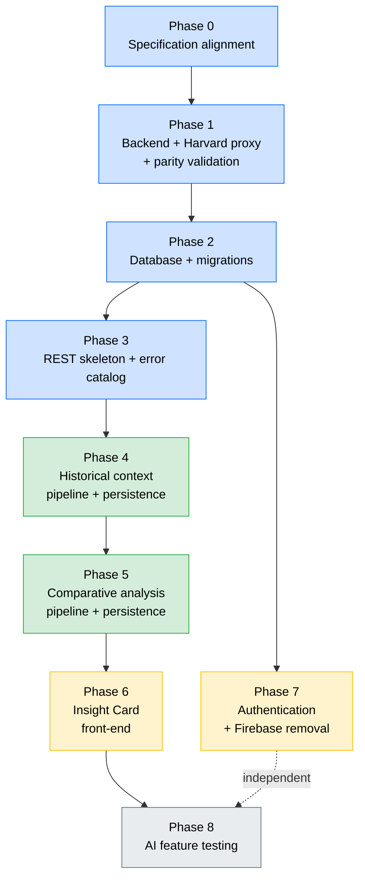

# Implementation Plan — Art Archive AI

**Version:** 1.0
**Date:** 2026-10-17
**Status:** In review
**Base documents:** [00 — Development Rules](./00-development-rules.md), [01 — Vision and Scope](./01-vision-scope.md), [04 — Architecture](./04-architecture.md), [05 — Database](./05-database.md), [06 — Persistence Flow](./06-persistence-flow.md), [07 — API Contract](./07-api-contract.md), [08 — Navigation Flow](./08-navigation-flow.md), [09 — AI Pipeline](./09-ai-pipeline.md), [11 — Prompt Engineering](./prompt-engineering/11-prompt-engineering.md)

---

## 1. Purpose

This is the document referenced as **"doc 99"** throughout the specification set — most importantly by doc 00 (§3.1), which makes following its phase order a conduct rule, and by doc 07 (§8), which defers two pending issues to its phases. Until this revision, that document was referenced by eight other documents but had never been written; every reference to "doc 99, Phase N" pointed at nothing.

It defines **what is built, in what order, and under which acceptance criteria** — it does not redefine *what the system does*. Every phase below points to the specification that governs it; where this document and a source specification disagree, the source specification wins (doc 00, §5).

**What this document is not:** it is not a calendar. No phase carries a date or a duration. The course-level milestones (official plan delivery, UX/QA refinement, final delivery between 2026-07-04 and 2026-07-10) live in doc 01 (§6.2) and in the Activity Plan, not here.

---

## 2. Scope of This Plan

### 2.1 In scope

| Block | Delivery | Phases |
| ----- | -------- | ------ |
| Infrastructure | Single Python backend replacing the Flask proxy; PostgreSQL; versioned migrations | 1, 2 |
| REST API | Error catalog, per-block endpoints, Harvard proxy contract | 1, 3 |
| AI core | Historical context and comparative analysis — pipeline, persistence, endpoints | 4, 5 |
| Insight Card | Front-end integration: combined states, disclosure notice, sources | 6 |
| Authentication | Email/password over PostgreSQL; Firebase fully removed | 7 |
| Validation | Testing of the AI generation feature against its FRs/NFRs | 8 |

### 2.2 Deferred — specified but not built in this cycle

These have approved specifications and remain valid requirements; they are simply **not scheduled in this plan**, by explicit decision of the author (2026-10-17). They are recorded here so the gap is visible rather than silently lost, per doc 00 (§4.2).

| Deferred item | Source specification | Consequence of deferring |
| ------------- | -------------------- | ------------------------ |
| **Alt Text** (RF-011, RF-012, RF-013) | doc 02.2; doc 06 §4; doc 07 §4; doc 09; doc 11.3 | `GET /artworks/{artwork_id}/alt-text` is not implemented. The artwork image's `alt` attribute keeps its current MVP behavior — `src/app/object/[objectId]/page.tsx` falls back to the Harvard `alttext` field or the artwork title, which is precisely the generic placeholder RF-012 forbids. **This is a known, accepted deviation from RF-012 for this cycle**, not an oversight. Doc 01's success criterion 3 ("every work processed by the pipeline has an Alt Text stored") is consequently not met by this cycle. |
| **ARIA / accessibility** (RF-014 through RF-025) | doc 02.3; RNF-004 | Neither the Insight Card's own ARIA requirements (RF-014 through RF-017) nor the sitewide ones (RF-018 through RF-025) are implemented. Doc 01's success criterion 4 (validated accessibility) is not met by this cycle. Phase 6 builds the Insight Card with semantic HTML, but performs no ARIA work and runs no screen-reader validation. |
| **Administrative panel** | doc 04 §4; doc 07 §6; doc 08 §7 | Not built. It additionally remains blocked on the unresolved `is_admin` pending issue (doc 08, §7). |

**The database schema is not reduced to match.** Phase 2 creates the `alt_text`, `alt_text_prompt_version`, and `alt_text_generated_at` columns exactly as doc 05 (§4) specifies. Removing them would be a structural change to an approved specification, which doc 00 (§2.6) forbids without explicit confirmation, and would make resuming Alt Text later require a second migration for no benefit. The columns are created and left `NULL`.

---

## 3. Decisions Recorded by This Plan

Doc 00 (§3.6) requires every technical decision not foreseen in a specification to be recorded explicitly rather than left implicit in code. The following were open at planning time and are decided here.

| # | Decision | Rationale |
| - | -------- | --------- |
| 1 | The new backend lives in a new top-level `backend/` directory, not by replacing the contents of `proxy/` | Matches the paths doc 11 (§4) already assumes for prompt storage (`backend/app/prompts/historical_context/v1.py`). Keeps the old proxy readable side by side during the parity validation of Phase 1, which doc 00 (§2.4) requires. "Proxy" also describes poorly a service that owns AI generation, persistence, and authentication. |
| 2 | **FastAPI** as the web framework, with SQLAlchemy 2.x (async) and Alembic | Doc 04 (§9, Decision 1) names FastAPI as an example rather than a mandate; this fixes it. Native `async` matters because every generation handler awaits a long external call (RNF-002, 60s), and native JSON-Schema-shaped response models align with the structured-output contract of doc 09 (§5). Doc 05 (§7) already commits to Alembic. |
| 3 | ~~`proxy/` is kept in the repository as historical reference~~ — **superseded 2026-10-27:** `proxy/` is deleted once parity is validated | The original decision would have amended doc 04 (§1 and §9, Decision 1). The author decided instead to remove the directory after the parity gate passed, which **restores doc 04's original text** — "Flask is discontinued at the end of the migration" — so no amendment to doc 04 is needed. The code remains recoverable from git history. |
| 4 | Backend service port: **8000** (FastAPI default), replacing Flask's 5000 | Doc 04 (§8) leaves the port "to be defined". Changing the number makes it impossible to accidentally hit the old Flask service during the parity window. `NEXT_PUBLIC_API_URL` is updated accordingly. |
| 5 | `GENERATION_TIMEOUT_SECONDS = 60`, read from the environment with that default | The value is fixed by RNF-002; making it configurable allows shortening it in tests without a code change. Doc 06 (§7) already references the constant by this name. |
| 6 | The front-end gets a **second Axios instance** for AI endpoints, with a **90s** timeout (revised from 60s, 2026-10-27) | `src/libs/axios/axios.ts` hardcodes `timeout: 10000`. A 10s client timeout would abort every first-visit generation long before the backend's 60s budget (RNF-002) elapses, making the Insight Card appear to fail on essentially every uncached artwork. The MVP instance keeps its 10s timeout for Harvard proxy calls. **Why 90s and not 60s:** RNF-002's 60s count from when generation is triggered, but the backend first reads the database (up to 8s, doc 06 §8) and checks the artwork with Harvard (up to 10s) — up to ~78s before it can answer. A 60s client limit would abort first, even before the backend's own `504` arrived. A client-side timeout is classified like a `504`, as RF-007 scenario 3 describes the case as requests that "exceed the configured time limit". |
| 7 | Password reset emails are **logged to the backend console** in development, not sent through a real SMTP provider | No specification names an email provider, and RF-029's observable behavior (identical response whether or not the email exists) does not depend on delivery actually happening. Phase 7 implements token generation, hashing, expiry, and single-use consumption in full; only the transport is stubbed. **This is a deviation from RF-029 scenario 029.1** ("the system sends a password-reset link to that email") and must be resolved before any deployment beyond the development environment. |
| 8 | API documentation is **generated by FastAPI** (Swagger UI at `/docs`, OpenAPI at `/openapi.json`), and a **Postman collection** with per-request tests lives in `backend/postman/` | The two are complementary, not redundant. The OpenAPI document is generated from the code, so it always reflects what the backend actually does — comparing it with doc 07 shows quickly whether the code drifted from the contract. The collection is maintained by hand and carries assertions, so running it (`newman run`) checks the contract end to end against a live server. Neither replaces doc 07, which stays the source of truth: when the contract changes, doc 07 changes first. The default `422` that FastAPI documents on every route is stripped from the OpenAPI document, since validation errors are returned as `400 VALIDATION_ERROR` (doc 07, §6.1). |

### 3.1 Specification corrections required (Phase 0)

| Document | Correction | Reason |
| -------- | ---------- | ------ |
| doc 02.1, RF-001 | Scenario 001.1 states "the back-end waits for both responses for persistence". Replace with per-block independent persistence. | Contradicts docs 04 (§7.1), 06 (§5), and 07 (§4) v2.1, which establish three independent requests with no backend aggregation. Those documents are more specific and win under doc 00 (§5.1), but RF-001 is the *source* requirement — leaving it stale means the code contradicts a requirement on its face. |
| ~~doc 04~~ | ~~Record the Decision 3 amendment~~ — **no longer required (2026-10-27):** `proxy/` was removed, so doc 04's original text stands unchanged. | — |
| doc 04 §8 | Record the backend port as 8000 (Decision 4). | Currently "to be defined". |
| doc 07 §8 | The closing line reads "resolve items 1 and 3" but the list contains only item 1. | Items 2 and 3 were resolved in doc 05 v2.1 (`password_reset_tokens` added) and the Alt Text endpoint split, and the list was trimmed without updating the closing line. |
| doc 02.4 | Remove the closing "Flag for confirmation" note. | It warns that docs 05 and 07 still describe Google OAuth. Both were corrected in their v2.1 revisions; the warning is now false. |
| doc 00 §7 | Add the deferrals of §2.2 above and the Decision 7 email-transport deviation to the pending-issues index. | Doc 00 (§8) requires that index to stay continuously current. |

---

## 4. Dependency Graph

**Phase 7 (Authentication) depends only on Phase 2** and is otherwise independent of the AI track. It is placed after Phase 6 in the numbering because the AI core is the project's academic contribution and carries the most technical risk — it should not wait behind authentication work. If the AI track stalls on an external blocker (Azure quota, API outage), Phase 7 is the correct thing to pull forward.

---

## 5. Phases

Each phase below gives: what it delivers, which specifications govern it, its acceptance criteria, and what must be true before it starts. A phase is **not complete** until every acceptance criterion is demonstrably met — doc 00 (§2.8) requires validation against the governing Gherkin scenarios before any FR implementation is considered done.

---

### Phase 0 — Specification Alignment

**Governed by:** doc 00 (§2.6, §3.4, §4)

**Delivers:** this document, plus the corrections listed in §3.1.

Doc 00 forbids starting a phase whose source specification does not exist, and requires specification documents to be kept current as implementation progresses. Four of the corrections in §3.1 are content fixes that doc 00 (§2.6) permits applying directly; the doc 04 amendment (Decision 3) is an architectural change and requires explicit author confirmation before being applied.

**Acceptance criteria**

- [ ] `99-implementation-plan.md` exists and is approved by the author
- [ ] RF-001 scenario 001.1 no longer contradicts docs 04/06/07
- [x] ~~Doc 04 records the retained-`proxy/` amendment~~ — dropped: `proxy/` removed instead, doc 04 needs no change. The port (8000) is still to be recorded in doc 04 §8
- [ ] Docs 07 §8 and 02.4 no longer carry stale notes
- [ ] Doc 00 §7 lists the deferrals and the email-transport deviation
- [ ] Doc 01 §9 index gains a row for this document

---

### Phase 1 — Backend Service and Harvard Proxy Migration

**Governed by:** doc 04 (§1, §4, §8); doc 07 (§3); doc 00 (§2.4)

**Delivers:** the FastAPI service in `backend/`, with the Harvard proxy endpoint reimplemented at contract parity, running in Docker Compose in place of Flask.

**Contract to preserve** — reading `proxy/proxy.py` directly, the entire behavior the front-end depends on is:

1. `GET /proxy/<path:endpoint>`, forwarding every query parameter to `https://api.harvardartmuseums.org/<endpoint>`
2. The `apikey` parameter injected server-side, never by the client (RNF-005)
3. `info.next` and `info.prev` stripped from the response body when present
4. A non-200 from Harvard surfaced as an error — now standardized as `502 HARVARD_API_ERROR` per doc 07 (§3)
5. CORS enabled for the front-end origin

The Flask routes `/api/login` and `/api/logout` are **not** migrated. They are Firebase-based, outside the new authentication specification (doc 02.4), and non-functional in the current code — `login_user` calls `auth.get_user_by_uid(id_token)` on what the front-end sends as a token, then calls `.decode()` on a string. There is no working behavior to preserve parity with, and doc 04 (§9, Decision 5) directs removing Firebase code once the new authentication works. Recording this here satisfies doc 00 (§2.4): the parity obligation is discharged by demonstrating there is no functioning behavior to lose, not by silently dropping the routes.

**Endpoints exercised by the front-end** (from the current code): `proxy/object/{id}`, `proxy/object/{id}/people`, `proxy/person/?id=`, plus the grid and filter queries issued from `src/app/home/`.

**Acceptance criteria**

- [ ] The new service answers `GET /proxy/{path}` with the Harvard body, `info.next`/`info.prev` removed
- [ ] The Harvard API key appears in no response body, no log line, and no front-end bundle (RNF-005)
- [ ] A Harvard error or non-JSON response yields `502 HARVARD_API_ERROR` in the standard error envelope (doc 07, §1)
- [ ] **Parity validation:** with the front-end pointed at the new service and Flask stopped, the artwork grid loads and scrolls, every filter section applies, the artwork detail page renders metadata, images, and artists, and the colors panel renders — all without console errors
- [ ] Only after that validation passes: `docker-compose.yml` drops the `api` Flask service and the `.firebaseAdminSDK.json` bind mount, and builds from `backend/` on port 8000
- [ ] `proxy/` remains in the repository, unreferenced by Compose (Decision 3)

> The parity validation is a hard gate under doc 00 (§2.4) — the Compose change must not be made before it passes.

#### Inherited MVP bugs fixed during this phase

The parity validation could not run as first attempted: both `/home` and `/object/{id}` returned HTTP 500 under SSR, from two pre-existing `window` accesses evaluated during render. Neither was introduced by this migration — `git log -L` dates the detail-page one to 2024-11-21, and no file under `src/` was modified before the failure was observed. They were fixed as part of this phase, by author decision (2026-10-17):

| File | Problem | Fix |
| ---- | ------- | --- |
| `src/app/home/page.tsx` | `window.innerWidth` in a `useEffect` dependency array (evaluated during render) | Width tracked in a `viewportWidth` state, set from a `resize` listener on mount. Also fixes a latent leak: the previous code passed *different* arrow functions to `addEventListener` and `removeEventListener`, so the listener was never removed |
| `src/app/object/[objectId]/page.tsx` | `window.innerWidth < 1500` read directly in JSX to pick the side-menu width | Same pattern, via an `isNarrowViewport` state |

Both are behavior-preserving for the user: the rendered widths and the resize response are unchanged on the client. Recorded here per doc 00 (§3.6), which requires technical decisions not foreseen in a specification to be documented rather than left implicit in code.

#### Parity validation result (2026-10-17)

Validated against the real Harvard Art Museums API, with the front-end pointed at the new service on port 8000 and the Flask proxy stopped:

| Check | Result |
| ----- | ------ |
| Contract points 1-4 (path, `apikey` injection, `info.next`/`prev` stripping, error mapping) | Pass — automated, `backend/tests/test_harvard_proxy_parity.py` |
| Harvard API key absent from every response body (RNF-005) | Pass — asserted in the same test |
| CORS preflight from `http://localhost:3000` | Pass |
| `/home` renders, grid populated | Pass — 295 artwork images loaded |
| `/object/299843` renders metadata, image, artist | Pass — title, artist, medium, culture, date all present in the rendered DOM |
| The four front-end call paths reach the new backend | Pass — confirmed in the backend access log |
| Runtime errors during the run | None |

Verified with headless Chrome rather than `curl`, since both pages are `"use client"` and fetch their data after hydration — a raw HTTP response contains only the loading skeleton.

**Filter endpoints**, covered in a second pass (2026-10-27): all nine the side menu consumes — `century`, `classification`, `color`, `culture`, `medium`, `period`, `place`, `technique`, `worktype` — return `200` with populated records through the new service. Combined with the ten endpoints compared byte-for-byte against the old Flask proxy, nineteen distinct endpoints are verified.

**Still not driven interactively:** infinite scroll, and the filter menu's own open/apply interaction. Both exercise request paths already confirmed above.

#### Flask proxy removed (2026-10-27)

With parity validated, `proxy/` was deleted from the repository — eight files, including three standalone scraping scripts referenced nowhere in the codebase. This supersedes Decision 3 (§3) and restores doc 04's original §1/§9 text, under which Flask is discontinued at the end of the migration. The code stays recoverable from git history.

---

### Phase 2 — Database and Versioned Migrations

**Governed by:** doc 05 (§4, §7); doc 04 (§8)

**Delivers:** the PostgreSQL container, the SQLAlchemy models, and Alembic migrations `0001` through `0005` in the order doc 05 (§7) fixes.

All five tables are created, including the three user-domain tables that Phase 7 will consume and the `alt_text*` columns that this cycle leaves `NULL` (§2.2). Doc 05's DDL is authoritative, down to the `pgcrypto` extension, the index names, and the `chk_artwork_ai_content_has_block` and `chk_sources_block_type` constraints.

**Acceptance criteria**

- [x] `docker-compose.yml` runs a `postgres` service with a named volume for persistence
- [x] `alembic upgrade head` on an empty database produces exactly the schema in doc 05 (§4)
- [x] `alembic downgrade base` reverses it cleanly
- [x] Every index and `CHECK` constraint named in doc 05 (§4) exists with that name
- [x] The connection string is read from the environment, never hardcoded (RNF-005)
- [x] A row with only `historical_context` filled, both other content columns `NULL`, inserts successfully — the partial state RF-004 scenario 3 requires

#### Result (2026-10-27)

Run against **PostgreSQL 18.6, installed natively on the development machine** rather than through Docker — the service was already present and running on `localhost:5432`, so the container was never needed locally. The `db` service is still defined in `docker-compose.yml`, with a named volume, so the stack remains reproducible elsewhere.

| Check | Result |
| ----- | ------ |
| `alembic upgrade head` → `downgrade base` → `upgrade head` | Clean round trip; schema identical afterwards (5 tables, 7 indexes, 2 CHECKs) |
| `alembic check` (models vs. migrated schema) | "No new upgrade operations detected" — no silent divergence |
| Schema conformance, 25 assertions | All pass — `backend/tests/test_schema_doc05.py` |
| Partial row, only `historical_context` (RF-004 scenario 3) | Accepted, other two blocks `NULL` |
| Per-column first-writer-wins upsert (doc 06 §6) | Merges a second block into the same row; discards a second write to the same block |
| `chk_artwork_ai_content_has_block` / `chk_sources_block_type` | Both reject their invalid rows |
| `ON DELETE CASCADE` on `artwork_content_sources` | Sources removed with their parent |

The upsert check matters beyond this phase: it is the exact concurrency mechanism Phases 4 and 5 depend on (doc 06, §6), verified before any pipeline code exists.

**Database provisioning**, done once outside the migrations: database `art_archive`, role `art_archive_user` (login, **not** superuser), `GRANT CONNECT` plus `USAGE, CREATE ON SCHEMA public` — required since PostgreSQL 15 stopped making `public` writable by default, without which Alembic fails — and `CREATE EXTENSION pgcrypto`, which needs superuser and therefore cannot live in a migration run by the application role. Migration `0001` still issues `CREATE EXTENSION IF NOT EXISTS pgcrypto`, a no-op when already provisioned, so a superuser-run deployment works unchanged.

#### Revision (2026-10-27) — surrogate key on `artwork_ai_content`

Following doc 05 v2.2 (Decision 12), migration **`0006_surrogate_key_artwork_ai_content`** replaces `artwork_id` as the primary key with a surrogate `id`, adds the partial unique index `ux_artwork_ai_content_active_artwork_id`, and moves `artwork_content_sources` onto `content_id`. It resolves the soft-delete/upsert conflict recorded in doc 06 (§11). Applied as a new migration rather than by rewriting `0004`/`0005`, which had already run.

| Check | Result |
| ----- | ------ |
| Upgrade over existing rows | Every source backfilled onto its parent row |
| Downgrade with one row per artwork | Reverses cleanly, sources back on `artwork_id` |
| Downgrade once a retired row sits beside an active one | Refuses with an explicit error, revision left at `0006` |
| `downgrade base` → `upgrade head` on an empty database | All six migrations, clean; `alembic check` reports no divergence |
| Schema suite (`test_schema_doc05.py`) | 39 assertions, all pass — including retire-and-recreate: the retired row and its sources are preserved, a fresh active row is created, a second active row is rejected |

The upsert's conflict target becomes `ON CONFLICT (artwork_id) WHERE expired_at IS NULL` — the clause PostgreSQL needs to infer a partial index, verified before the specification was written.

---

### Phase 3 — REST Skeleton and Error Catalog

**Governed by:** doc 07 (§1, §4, §6); doc 06 (§2, §3)

**Delivers:** the two Insight Card endpoints routed, validated, and returning the shape doc 07 specifies, with generation still stubbed; plus the shared error envelope and the `404 ARTWORK_NOT_FOUND` check.

| Endpoint | Status after this phase |
| -------- | ----------------------- |
| `GET /artworks/{artwork_id}/historical-context` | Routed; existence check against Harvard; DB read; returns `200` with empty text where generation would occur |
| `GET /artworks/{artwork_id}/comparative-analysis` | Same |
| `GET /artworks/{artwork_id}/alt-text` | **Not implemented** (§2.2) |

The `404 ARTWORK_NOT_FOUND` case is the pending issue doc 07 (§8, item 1) raised: the artwork-does-not-exist path is specified in doc 07 (§4) but was never added as a node to doc 06's flowcharts. It is implemented per doc 07 — verified against the Harvard API before any pipeline call — and doc 06 should gain the corresponding node.

**Acceptance criteria**

- [x] Both endpoints return exactly the JSON shape in doc 07 (§4), field names included
- [x] Every error in the catalog (doc 07, §6) reachable by these endpoints returns the standard envelope with the documented `code`
- [x] A nonexistent `artwork_id` returns `404 ARTWORK_NOT_FOUND` before any pipeline or LLM call
- [x] An already-persisted block is read from the database and returned, filtered on `expired_at IS NULL` (doc 05, §8)
- [x] CORS permits the front-end origin

#### Specification gaps resolved during this phase (2026-10-27)

Two behaviours the endpoints need were not specified anywhere. Both were raised with the author before implementation (doc 00, §4.2) and are now recorded in doc 07 v2.2:

| Gap | Author decision | Recorded in |
| --- | --------------- | ----------- |
| Harvard fails while the artwork's existence is being checked | `502 HARVARD_API_ERROR`, extending a code already in the catalog | doc 07 §4, §6.1; doc 06 §2, §3 |
| Errors raised by the framework escape the envelope (`422` on a non-integer `artwork_id`, `{"detail": ...}` on an unknown route) | `400 VALIDATION_ERROR` for invalid input; reason-phrase codes (`NOT_FOUND`, `METHOD_NOT_ALLOWED`) for other framework errors; `500 INTERNAL_ERROR` for unhandled exceptions — all in the envelope | doc 07 §6.1 |

One observed fact shaped the implementation: **Harvard answers a nonexistent object with HTTP `200` and `{"error": "Not found"}`, not with a `404`** — including for non-numeric and negative IDs. A check based on the status code alone would have treated every nonexistent artwork as valid. Recorded in doc 07 (§4).

Two further pending issues surfaced while drawing the existence check into doc 06, neither blocking: a soft-deleted row can never be persisted again under the per-column upsert, and a database read failure is unspecified. Both are recorded in doc 06 (§11) and indexed in doc 00 (§7).

#### Result (2026-10-27)

| Check | Result |
| ----- | ------ |
| `backend/tests/test_insight_card_endpoints.py` — in-process, real database, fake Harvard client | 32 assertions, all pass |
| Postman collection via Newman, against the live server and the real Harvard API | 13 requests, 29 assertions, 0 failures |
| Phase 1 proxy parity suite, after moving the proxy onto the shared error envelope | 14 assertions, all pass |
| Real Harvard client: existing, nonexistent, rejected key, unreachable | Classified correctly; the API key never appears in error messages (RNF-005) |

The fake Harvard client is what makes two guarantees testable: a persisted block is served **without consulting Harvard at all** (RNF-001), and a Harvard outage maps to `502`. Seeded rows use negative artwork IDs, which Harvard never issues, and are removed after the run.

Generation remains stubbed: an artwork that exists but has nothing persisted returns `200` with an empty block — the same response the endpoint gives when the model has nothing reliable to say, so the contract already holds and the front-end of Phase 6 can be built against it. The stub is marked `PROVISIONAL` in `backend/app/persistence/insight_card.py`.

#### Revision (2026-10-27) — unreadable database treated as a missing block

By author decision (doc 06, §11 item 2), a database that cannot be read during the check no longer surfaces as `500 INTERNAL_ERROR`: the block is treated as missing and the flow continues, persisting nothing. Two findings shaped the implementation:

- **Connection failures are not SQLAlchemy errors.** Probed against a closed port, an unreachable host and rejected credentials, the driver raised `ConnectionRefusedError`, `OSError`, `TimeoutError` and asyncpg's own exceptions, unwrapped. The fallback therefore catches those families explicitly; catching `SQLAlchemyError` alone would have let an outage through as a `500`.
- **An unreachable host took ~21s to fail** with no limit configured. Connection and query timeouts of 3s and 5s now keep the fallback inside RNF-002's window (doc 06, §8).

Endpoint suite: 40 assertions, all pass. The database-unreadable case runs against a session on a closed port, so it exercises the driver's real exceptions rather than a simulated one.

---

### Phase 4 — Historical Context: Pipeline and Persistence

**Governed by:** doc 09 (§3 through §10); doc 06 (§2, §6, §7); doc 11.1; RF-002, RF-004, RF-009, RF-010; RNF-001, RNF-002, RNF-003, RNF-006

**Delivers:** `generate_historical_context()` and the complete `get_or_generate_historical_context()` handler behind the live endpoint.

> **Note on the original 8-item schedule:** this plan merges what that schedule listed as items 4 and 6 ("AI pipeline" and "on-demand persistence" as separate deliveries). Doc 06 (§7) shows the persistence check is not a wrapper added around a finished pipeline — it *is* the request handler, and the pipeline is the function it conditionally calls. Building them separately would mean building the handler twice. Each AI phase here therefore delivers one block end to end: check, generate, persist, respond.

**The four pipeline steps** (doc 09, §4 through §7), in order:

1. **Image accessibility validation** — a lightweight `HEAD` with a short timeout, outside the 60s budget. Failure raises `ImageUnavailableError` before incurring any LLM cost.
2. **Prompt assembly** — system and user messages exactly as doc 11.1 (§1, §2) specifies, under `prompt_version = "v1"`, stored at `backend/app/prompts/historical_context/v1.py` per doc 11 (§4). Absent metadata fields are omitted from the template, never labeled as missing.
3. **Azure OpenAI call** — the shape in doc 11 (§3): `temperature` 0.35, `max_tokens` 700, `response_format` the JSON Schema of doc 11.1 (§3), web search enabled (RF-009), **no automatic retry** (doc 09, §8, Decision 3).
4. **Structural validation** — `is_structurally_valid()` per doc 09 (§7). An empty `text` is a valid outcome, not a failure; `sources` must be `[]` whenever `text` is `""`.

**Outcome mapping** (doc 06, §2; doc 09, §10) — the part easiest to get wrong:

| Outcome | HTTP | Persisted? |
| ------- | ---- | ---------- |
| Non-empty text | `200` with text and sources | Yes — per-column upsert |
| Empty text (insufficient information, or no relevant source) | `200`, `historical_context: ""` | No — retried next visit |
| `ImageUnavailableError`, `LLMProviderError`, `LLMIncompleteResponseError` | `200`, `historical_context: ""` | No |
| `LLMTimeoutError` (60s elapsed) | `504 GENERATION_TIMEOUT` | No |
| Generated successfully, database write fails | `200` with the generated text | No — logged, never surfaced (RF-004 scenario 2) |

Only a timeout produces a `5xx`. Every other failure is indistinguishable from "the model had nothing reliable to say" — a deliberate departure from the pre-v2.1 contract, which used `502 GENERATION_FAILED`.

**Persistence** uses the per-column, first-writer-wins upsert of doc 06 (§6), guarded by `WHERE artwork_ai_content.historical_context IS NULL`. Sources are written to `artwork_content_sources` with `block_type = 'historical_context'`.

**Acceptance criteria**

- [ ] Scenario 002.1 — valid image and complete metadata produce non-empty text mentioning period and movement
- [ ] Scenario 002.2 — missing metadata fields yield text built only from the fields present, with nothing invented and no error
- [ ] Scenario 002.3 — insufficient information yields `""`, nothing persisted, regeneration attempted on the next visit
- [ ] Scenario 004.1 — non-empty content is persisted under `artwork_id` with its `prompt_version` and `generated_at`
- [ ] Scenario 004.2 — a simulated write failure still returns `200` with content, logs the error, surfaces nothing to the client
- [ ] Scenario 010.1 — sources are returned alongside the text and stored in `artwork_content_sources`
- [ ] Scenario 010.2 — no relevant source yields `""` and `[]`, treated as a non-error
- [ ] RNF-001 — a second request for the same artwork is served from the database in ≤500ms (p95), with no LLM call
- [ ] RNF-002 — a call exceeding 60s returns `504 GENERATION_TIMEOUT`
- [ ] RNF-006 — `historical_context_prompt_version` reads `v1` on every persisted row
- [ ] Concurrency — two simultaneous requests for the same uncached artwork both return content; exactly one write lands; neither returns a `5xx`

---

### Phase 5 — Comparative Analysis: Pipeline and Persistence

**Governed by:** doc 09; doc 06 (§3, §6, §7); doc 11.2; RF-003, RF-004, RF-009, RF-010; RNF-001, RNF-002, RNF-003, RNF-006

**Delivers:** `generate_comparative_analysis()` and `get_or_generate_comparative_analysis()`, mirroring Phase 4 in every structural respect.

Doc 06 (§3) states this flow "mirrors Section 2 in every respect". What differs: the prompt (doc 11.2, which asks for 2–4 paragraphs referencing at least one comparable artist or artwork), the column pair, `block_type = 'comparative_analysis'`, and the exception type. Everything else — the four steps, the outcome mapping, the upsert guard, the error semantics — is identical.

The shared structure should be factored only as far as Phase 4 and Phase 5 actually demand. Doc 00 (§3.3) forbids generalizing beyond what the current specification requires; a generic "block pipeline" abstraction anticipating a third caller is exactly that, especially given Alt Text is deferred.

**Acceptance criteria**

- [ ] Scenario 003.1 — valid input produces non-empty text referencing at least one artist or artwork with a similar period, technique, or culture
- [ ] Scenario 003.2 — no confident comparison available yields `""`, nothing persisted, no fabricated comparison
- [ ] Scenario 004.3 — when one block returns content and the other `""`, only the non-empty block is written; the row is legitimately partial
- [ ] The full Phase 4 criteria list, applied to this block: persistence, write-failure handling, sources, RNF-001, RNF-002, RNF-006, concurrency
- [ ] Independence — with `historical_context` already persisted and `comparative_analysis` missing, only one LLM call is made (RF-001 scenario 001.4)

---

### Phase 6 — Insight Card on the Front-End

**Governed by:** doc 06 (§5); doc 08 (§6); RF-001, RF-005, RF-006, RF-007, RF-008, RF-010; RNF-007, RNF-008

**Delivers:** the Insight Card in `src/app/object/[objectId]/components/insightCard/` (the location doc 04, §3 fixes), rendered on the artwork detail page.

**The aggregation rule** (doc 06, §5) is the heart of this phase and lives entirely client-side — the backend never combines the two responses:

1. Both requests fire in parallel on page load, neither waiting on the other
2. Loading persists until **both** settle — `Promise.allSettled`, never a transition on one
3. At least one response has non-empty text → **Displayed**, rendering only the non-empty block(s), with no placeholder for the other
4. Neither has content, and both were `504` → **Error**, timeout message: *"The request took too long. Please try again later."*
5. Neither has content, any other combination → **Error**, standard message: *"Was not possible to generate an educational text for this artwork."*

The two blocks render as paragraphs inside a single **"Context information"** section. RF-005 is explicit that they must not appear as separately titled subsections.

**Disclosure notice** (RF-008): *"This content was generated by artificial intelligence and may contain inaccuracies."* — shown whenever content renders, whether freshly generated or served from the database. The wording is fixed; it must not be paraphrased.

**Sources** (RF-010) render alongside their corresponding block when present.

**Front-end changes required outside the component:**

- A second Axios instance with a 90s timeout for these two endpoints (Decision 6). The existing 10s instance would abort nearly every first-visit generation.
- `NEXT_PUBLIC_API_URL` repointed to port 8000.
- Insertion into `src/app/object/[objectId]/page.tsx`, **after the artwork's "Description" block** — by author decision (2026-10-27), which revised RNF-007 (doc 02.5). This plan first suggested a position *before* Description, which would not have met the original RNF-007 either: measured at 1024×768, only a card directly below the image kept its indicator on screen (y=714–734 of 768).

**Not in this phase** (§2.2): ARIA attributes, `aria-live` announcement of state transitions (RF-015), and any screen-reader validation. Semantic HTML is used throughout, which keeps the later ARIA phase cheap, but no accessibility claim is made or tested here.

**Acceptance criteria**

- [x] Scenario 005.1 — both blocks render as paragraphs within one "Context information" section, neither under its own title
- [x] Scenario 005.2 — one block empty renders only the other, with no placeholder, blank paragraph, or error
- [x] Scenario 005.3 / 007.2 — both without content, not both `504`, renders the standard message
- [x] Scenario 005.4 — long content starts collapsed behind "See more", expands and collapses again, and never hides the disclosure notice (added 2026-10-27)
- [x] Scenario 007.1 — one block fails, the other succeeds: no error appears anywhere in the card
- [x] Scenario 007.3 — both `504` renders the timeout-specific message
- [x] Scenario 006.1 — loading is visible while either request is in flight, and the rest of the page stays usable
- [x] Scenarios 008.1 and 008.2 — the disclosure notice appears on both freshly generated and cached content, in its exact specified wording
- [x] RNF-007 (revised) — the loading indicator sits on the section's heading row, visible as soon as the section is
- [x] RNF-008 — with the backend's AI endpoints failing, the detail page's metadata, images, and colors remain functional; the grid and filters never call those endpoints
- [x] The card never renders one block before the other (RF-001)

#### Scheduling note (2026-10-27)

**Phase 6 was built ahead of Phases 4 and 5**, by author decision: those phases need Azure OpenAI credentials not yet available. The card's real dependency is the API contract, in place since Phase 3, so it could be built and wired now. Until the AI pipeline exists, it runs on a **mock data source**:

- `NEXT_PUBLIC_INSIGHT_CARD_SOURCE` selects `api` (the backend — the default, so nobody sees mock data by accident) or `mock`.
- In mock mode, `?insightCardMock=<scenario>` reproduces each Gherkin scenario: `both` (default, long enough to collapse), `short`, `historical-only`, `comparative-only`, `both-empty`, `mixed-failure`, `both-timeout`, `pending`. Mock content is labelled on screen with a "Mock data" badge.
- Both sources produce the same outcome type, so switching to real data is the variable alone — no code change.

**This phase must be re-validated once Phases 4 and 5 land**, against real generations: real text lengths, real sources, and real `504`s.

#### Result (2026-10-27)

| Check | Result |
| ----- | ------ |
| Every mock scenario, in headless Chrome against the running front-end | 46 assertions across 8 scenarios, all pass — expected texts present, and the ones that must not appear (errors, disclosure, the other block) absent |
| Displayed structure | Historical context before comparative analysis; paragraphs only, no subtitles inside the section (RF-005); each block's sources beneath it |
| "See more" cycle, driven by clicks through the DevTools Protocol | Long content starts at 156px of 1,310; "See more" expands it fully and becomes "See less"; collapses again. Short content shows in full with no control. Disclosure visible in every state |
| Placement | After "Description", before the remaining details |
| RNF-007 (revised), at 1024×768 | Indicator 24–44px from the card's top edge, on the heading row |
| `api` source, against the Phase 3 backend | Both requests reach the real endpoints; the stub's empty blocks render the standard message |
| `api` source, against a stand-in server | A real `504` renders the timeout message; real content renders with its sources |

**Security — sources are LLM output rendered as links.** The `api` source keeps only `http(s)` URLs: a `javascript:` URL in an `href` would run on click. Fed `javascript:alert(1)`, an `ftp://` URL and a non-string through the stand-in server, only the `https://` source reached the page.

---

### Phase 7 — Authentication over PostgreSQL and Firebase Removal

**Governed by:** doc 02.4 (RF-026 through RF-031); doc 03.4 (UC-15 through UC-20); doc 07 (§5); doc 08 (§5); doc 05 (§5.1, §5.2, §5.3)

**Delivers:** the six authentication endpoints, the two missing screens, and the complete removal of Firebase from the repository.

**Endpoints** (doc 07, §5): `POST /auth/register`, `POST /auth/login`, `POST /auth/logout`, `POST /auth/password-reset/request`, `POST /auth/password-reset/confirm`, `GET /auth/session`.

**Non-negotiable security properties**, each traced to a specification:

- Email and password are the **sole** credential — no third-party identity provider at any step (RF-026)
- Passwords stored as bcrypt or argon2 hashes; session and reset tokens stored **hashed**, never in plain text (doc 05, §5.2, §5.3)
- Login failure never reveals whether the email or the password was wrong (RF-026 scenario 026.2)
- `POST /auth/password-reset/request` returns the same `200` whether or not the email exists (RF-029)
- Reset tokens are single-use via `used_at` and expiring via `expires_at` (RF-030)
- Sessions are revocable immediately by setting `revoked_at` — this is why doc 05 (§6, Decision 3) chose a `sessions` table over stateless JWT (RF-028)
- The session cookie is `httpOnly; Secure; SameSite=Lax`, named `user_session` to match the `SESSION_COOKIE_NAME` already in `src/constants.ts`, and the token never appears in a response body (doc 07, §5)

**Front-end work:** `src/app/login/` and `src/app/signUp/` are rewired from inert Firebase calls to the new endpoints; `useUserSession` consumes `GET /auth/session` (RF-031); `src/middleware.ts` validates sessions issued by the new backend. The **Forgot Password** and **Change Password** screens are built — doc 08 (§2) records that both were planned in the original MVP diagram and never implemented.

**Firebase removal** (doc 04, §9, Decision 5): `src/libs/firebase/` deleted, `firebase_admin` dropped from the backend dependencies, the `.firebaseAdminSDK.json` bind mount removed from Compose, and `NEXT_PUBLIC_FIREBASE_API_KEY` removed from `.env.template`. No transition window applies — no Firebase user data is migrated (doc 00, §2.5; doc 05, §1).

Email transport is stubbed per Decision 7 — a deviation from RF-029 that must be closed before any non-development deployment.

**Acceptance criteria**

- [ ] UC-15 — valid credentials authenticate, create a session, and redirect; invalid credentials create no session and yield a message that does not identify the wrong field
- [ ] UC-16 — sign-up creates a user who can immediately log in; a duplicate email yields `409 EMAIL_ALREADY_EXISTS` and leaves the existing account untouched
- [ ] UC-17 — logout sets `revoked_at`, and the revoked session is rejected on the next authenticated request
- [ ] UC-18 — the reset request returns an identical response for registered and unregistered emails; a hashed token row is created only in the former case
- [ ] UC-19 — a valid token sets the new password and is consumed; an invalid, used, or expired token yields `400 INVALID_OR_EXPIRED_TOKEN` and changes nothing
- [ ] UC-20 — the session survives a page reload and a browser restart until it expires or is revoked
- [ ] No plain-text password or token exists anywhere in the database
- [ ] No Firebase code, dependency, credential, or environment variable remains in the repository
- [ ] `src/middleware.ts` protects routes using the new session cookie

---

### Phase 8 — Testing of the AI Generation Feature

**Governed by:** doc 02.1; doc 03.1 (UC-01 through UC-04); doc 02.5 (RNF-001, RNF-002, RNF-003, RNF-005, RNF-006, RNF-007, RNF-008); doc 00 (§2.8)

**Delivers:** validated evidence that the Insight Card generation pipeline satisfies its requirements end to end.

Phases 4 through 6 each validate their own block in isolation. This phase validates the **feature**, across the full stack, in the four use cases of doc 03.1 — and produces the record of that validation, which is what doc 12 (Test Plan) and doc 13 (Test Report) will consume.

**Use-case coverage:**

| Use case | What is exercised |
| -------- | ----------------- |
| UC-01 | First visit, neither block cached: two separate LLM calls, non-empty blocks persisted, single loading state, card rendered only once both settle |
| UC-02 | Return visit, both cached: no LLM call, ≤500ms per block |
| UC-03 | One block cached: exactly one LLM call, both blocks shown together |
| UC-04 | Both fail: standard message for mixed or non-timeout failures, timeout-specific message when both are `504`, rest of page functional |

**Non-functional verification**, using the methods each NFR names:

- **RNF-001** — load test (K6 or equivalent) against both endpoints with the database pre-populated, measuring each block independently against the 500ms p95 bar
- **RNF-002** — end-to-end timing against real Azure OpenAI calls, covering both "both blocks pending" and "one pending"
- **RNF-003** — after each successful generation in the test run, query the database directly; the loss rate must stay within the 1% budget
- **RNF-005** — grep the repository, the built front-end bundle, and the backend logs for key patterns; zero occurrences
- **RNF-006** — confirm `prompt_version` is populated on every persisted row
- **RNF-007** — visual inspection at 1024×768: the loading indicator is visible without scrolling
- **RNF-008** — with Azure OpenAI unreachable, confirm the grid, filters, and detail page remain fully functional

**Scope boundary:** this phase does **not** test Alt Text or accessibility — both are deferred (§2.2). Doc 12's test plan, when written, must record that exclusion so the gap is not mistaken for a passing result.

**Acceptance criteria**

- [ ] Every Gherkin scenario in doc 02.1 (RF-001 through RF-010) passes, excluding those referencing Alt Text
- [ ] Every acceptance criterion in doc 03.1 (UC-01 through UC-04) passes
- [ ] Each NFR above is verified by the method it specifies, with the result recorded
- [ ] Failures found are either fixed, or recorded as pending issues per doc 00 (§4) — never silently accepted
- [ ] The results are written up in a form doc 13 can consume

---

## 6. Phase-to-Requirement Traceability

| Phase | Functional requirements | Non-functional requirements | Use cases |
| ----- | ----------------------- | --------------------------- | --------- |
| 0 | — | — | — |
| 1 | — (MVP-inherited) | RNF-005, RNF-008 | — |
| 2 | RF-004, RF-013 (schema only) | RNF-003, RNF-005, RNF-006 | — |
| 3 | RF-001 | RNF-001 | UC-02 |
| 4 | RF-001, RF-002, RF-004, RF-009, RF-010 | RNF-001, RNF-002, RNF-003, RNF-006 | UC-01, UC-02, UC-03 |
| 5 | RF-001, RF-003, RF-004, RF-009, RF-010 | RNF-001, RNF-002, RNF-003, RNF-006 | UC-01, UC-02, UC-03 |
| 6 | RF-001, RF-005, RF-006, RF-007, RF-008, RF-010 | RNF-007, RNF-008 | UC-01, UC-03, UC-04 |
| 7 | RF-026 through RF-031 | RNF-005 | UC-15 through UC-20 |
| 8 | RF-001 through RF-010 | RNF-001, RNF-002, RNF-003, RNF-005, RNF-006, RNF-007, RNF-008 | UC-01 through UC-04 |

**Requirements not covered by any phase in this cycle:** RF-011, RF-012, RF-013 (Alt Text generation and application); RF-014 through RF-025 (ARIA); RNF-004 (WCAG 2.1 AA). See §2.2.

> The complete matrix, connecting requirements to architecture components and test cases, will be formalized in document 16 — Requirements Traceability Matrix.

---

## 7. Progress Checklist

Doc 00 (§3.4) requires this checklist to be kept current as implementation progresses.

| Phase | Delivery | Status |
| ----- | -------- | ------ |
| 0 | Specification alignment | 🚧 In progress — doc 04 amendment pending author confirmation |
| 1 | Backend service + Harvard proxy + parity validation | ✅ Done (2026-10-17) |
| 2 | Database + migrations | ✅ Done (2026-10-27) |
| 3 | REST skeleton + error catalog | ✅ Done (2026-10-27) |
| 4 | Historical context: pipeline + persistence | ⬜ Not started |
| 5 | Comparative analysis: pipeline + persistence | ⬜ Not started |
| 6 | Insight Card on the front-end | ✅ Done on mock data (2026-10-27) — built ahead of Phases 4–5; re-validate with real generation |
| 7 | Authentication + Firebase removal | ⬜ Not started |
| 8 | AI generation feature testing | ⬜ Not started |

Legend: ⬜ Not started · 🚧 In progress · ✅ Done

---

## 8. Risks Carried by This Plan

Formal treatment — probability, impact, mitigation — belongs to **doc 15 (Risk Management Plan)**. Listed here are only the risks this plan's structure creates or inherits.

| Risk | Phase | Note |
| ---- | ----- | ---- |
| Harvard proxy rewrite regresses MVP functionality | 1 | Already flagged in doc 04 (§11). Mitigated by making parity validation a hard gate. |
| Azure OpenAI quota or cost exceeds the educational budget | 4, 5, 8 | Doc 01 (§8, assumption 2) assumes sufficient quota. Phases 4, 5, and 8 all make real calls; Phase 8's load testing is the heaviest consumer. Prefer a small fixed set of test artworks over broad sampling. |
| Generation quality is poor enough to require prompt iteration | 4, 5 | Doc 11 (§5) anticipates this and defines the process. Every new version needs a version-log row *before* becoming active (doc 11, §4). Budget for at least one iteration per block. |
| The 60s client timeout change is forgotten | 6 | Decision 6. The failure mode is silent and misleading: every first visit appears to fail with a generic error while the backend is still working normally. |
| Deferred Alt Text and ARIA read as unmet success criteria | — | Doc 01 (§7) criteria 3 and 4 are explicitly not met by this cycle (§2.2). This must be stated plainly in the final report rather than left for the committee to discover. |
| No CI/CD pipeline exists | all | Doc 04 (§11). Every validation in this plan is manual; an unrun check is indistinguishable from a passing one. |

---

## 9. Maintenance

This document is updated whenever a phase changes status (§7), a decision in §3 is revised, or a deferral in §2.2 is resumed or made permanent. Changes to phase *order* or to the scope of §2.2 are structural and require author confirmation before being applied (doc 00, §2.6).
